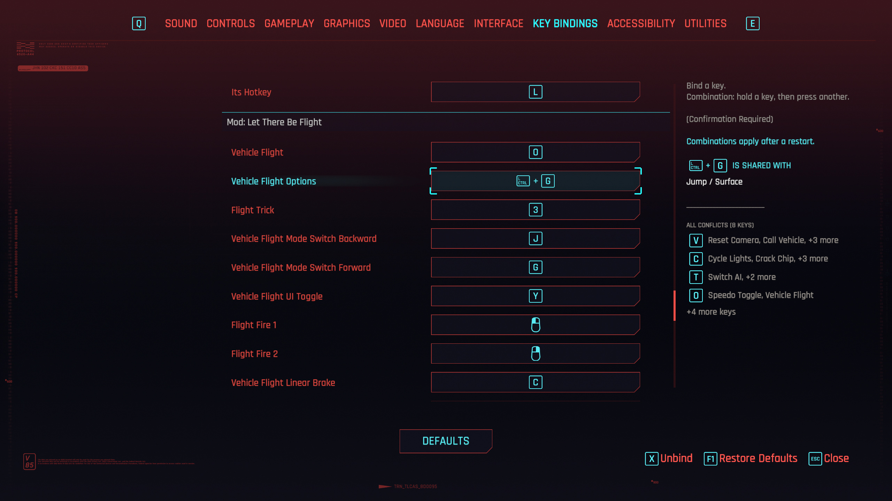
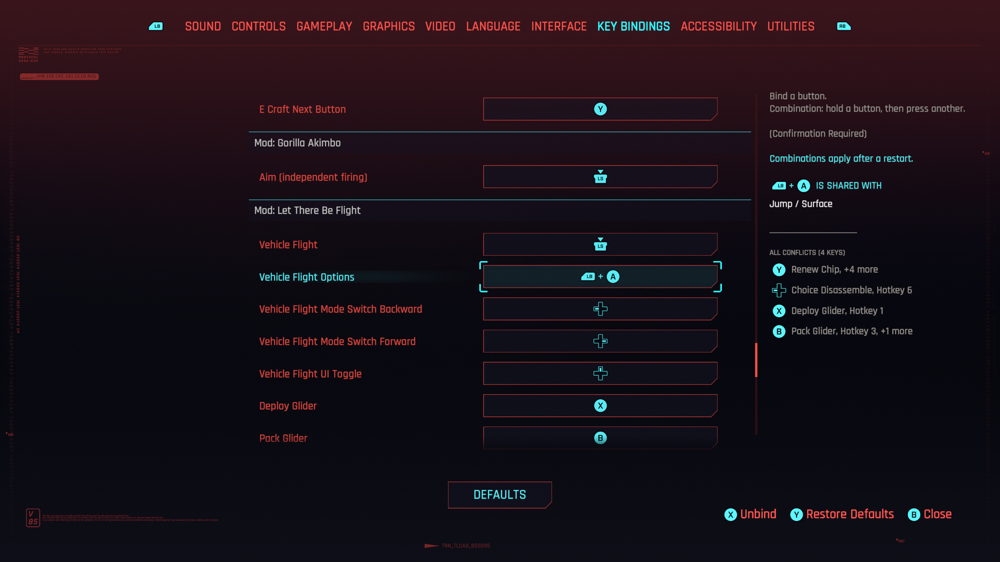
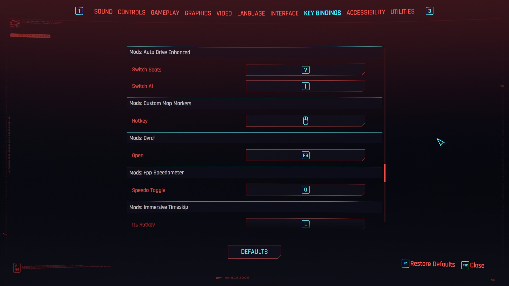
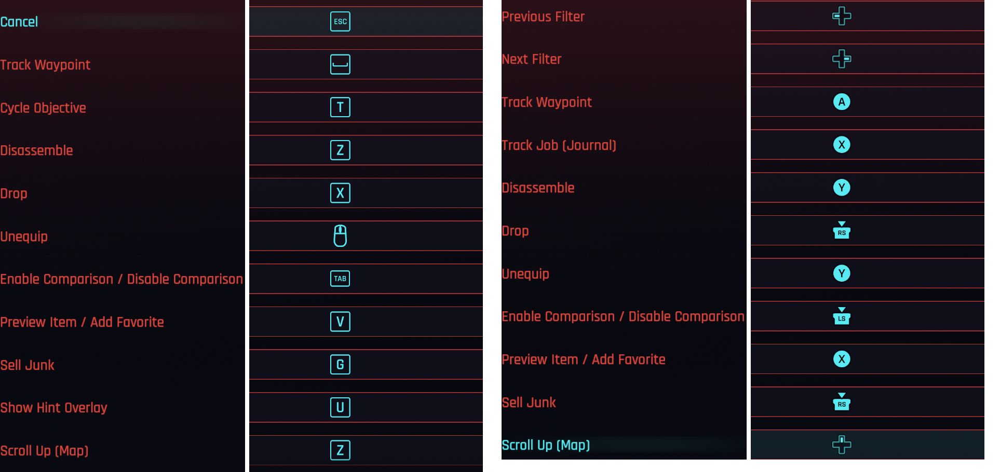
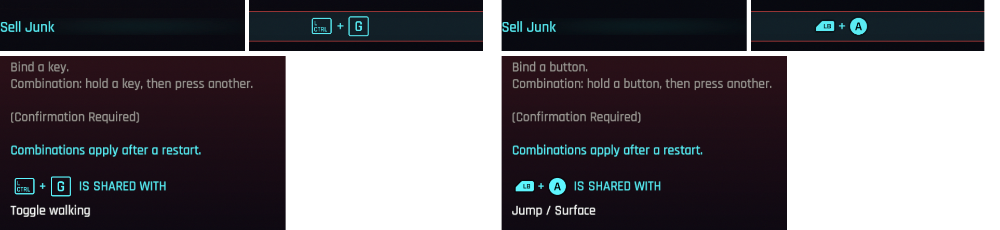
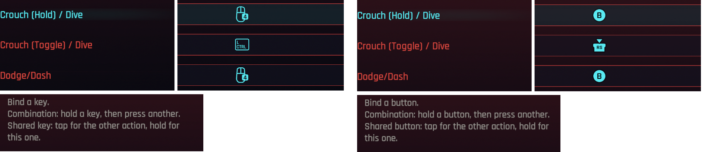

# Unified Keybinds

Every mod key and controller button, rebindable in the game's own Key Bindings menu.





One section per installed mod in **Settings > Controls > Key Bindings**, built at every startup. Rebind everything in one place, with a keyboard or a controller.

## Features

Images: keyboard left, controller right.

- **One section per mod**, named from the mod's files, for example *"Mod: Let There Be Flight"*. Includes keys the mod never made rebindable.

  

- **Hard-coded game keys rebindable**: Confirm, Cancel, Drop, Disassemble, Unequip, Sell Junk, Preview Item / Add Favorite, Comparison, Track Waypoint, Cycle Objective, map filters and more, on keyboard and controller. On-screen hints follow your keys.

  

- **Controller rebinding**, vanilla and mod, per control scheme (Classic, Dynamic, Alternative). The menu shows buttons while you use a controller, keys while you use the keyboard.

- **Key combinations** on every entry: hold one key or button, press another (*"Ctrl + K"*, *"LB + A"*). On-screen hints show the whole combination.

  

- **Tap or hold on one key**: a (Hold) action shares its key with another action. Tap for one, hold for the other, for example Crouch (Hold) and Dodge/Dash.

  

- **Conflict warning**: a popup names new conflicts. The side panel lists what the selected key conflicts with, what it is shared with, and every conflicting key. Keys used in different contexts (Jump and the map's Track Waypoint) are not conflicts.

  

- **Unbind** any entry: point at it and press **X** (Square on a controller). **Defaults** restores it.
- **Sync** with Mod Settings, Native Settings UI and Redscript Configuration Framework, both ways.
- Changes apply at once. Keys are stored in a separate file with a backup. No game or mod files are changed.

## Supported keybind sources

| Status | Keybind source | Notes |
| --- | --- | --- |
| Native | Input Loader input files (for example Let There Be Flight, Enhanced Vehicle System) | Keys and controller buttons, also ones the mod didn't make rebindable. A mod that registers its file late may appear from the second launch. |
| Native | Mod Settings key options | Synced both ways. Combinations stay in this menu. |
| Native | Redscript Configuration Framework | Hub key (F8) synced with RCF's Options. |
| 2nd launch | Native Settings UI, Unified Mod Settings | Single keys. Synced both ways. |
| 2nd launch | Mods with keys in RCF's hub, like the DigitalVixen mods | With the mod's own names. Single keys and controller buttons. Synced both ways. |
| Native | No More Hard-coded Keybinds | Covered: every key it adds is an entry. Both can be installed. |
| Native | Vanilla keys and buttons | The game's own entries, with combinations. Controller layouts per control scheme. |
| Not yet | Cyber Engine Tweaks hotkeys | Stay in the CET overlay. |

## Limitations

> [!WARNING]
> - Controller: only actions on exactly one button are listed. Movement, aiming, attacking and sticks stay as they are.
> - Key combinations apply after a restart, about 30 in total.
> - Map zoom stays on the mouse wheel.

## Requirements

- Cyberpunk 2077 **2.5**
- [RED4ext](https://www.nexusmods.com/cyberpunk2077/mods/2380), [redscript](https://www.nexusmods.com/cyberpunk2077/mods/1511), [Input Loader](https://www.nexusmods.com/cyberpunk2077/mods/4575), [Codeware](https://www.nexusmods.com/cyberpunk2077/mods/7780)
- Optional: [Mod Settings](https://www.nexusmods.com/cyberpunk2077/mods/4885), [Cyber Engine Tweaks](https://www.nexusmods.com/cyberpunk2077/mods/107) with [Native Settings UI](https://www.nexusmods.com/cyberpunk2077/mods/3518), [Redscript Configuration Framework](https://www.nexusmods.com/cyberpunk2077/mods/30726)

## Installation

Mod Organizer 2, Vortex, or extract into the game folder.

## Uninstallation

Remove `red4ext/plugins/ModKeybindsMenu` and `bin/x64/plugins/cyber_engine_tweaks/mods/ModKeybindsMenu`. Optionally delete `r6/cache/modkeybinds/` (your mod keys). Nothing is written to your save. Game settings are kept.

## For mod authors

Any Input Loader action with `overridableUI`, or a `Button` mapping with a single key or `buttonGroup`, shows up automatically. For nicer names, ship `r6/config/modkeybinds/<YourMod>.json`:

```json
{
  "_section": "Your Mod",
  "yourActionName": "Open Menu"
}
```

Names can be `LocKey#...` keys.

## Credits and source

Uses [RED4ext.SDK](https://github.com/wopss/RED4ext.SDK), [pugixml](https://github.com/zeux/pugixml) and [nlohmann/json](https://github.com/nlohmann/json). Input manager layouts and address hashes from [Mod Settings](https://github.com/jackhumbert/mod_settings). MIT, see [LICENSE](LICENSE).

## Technical notes

<details>
<summary>How it works</summary>


- A RED4ext plugin compares Input Loader's merged `r6/cache/inputUserMappings.xml` with the game's `r6/config/inputUserMappings.xml`. Every `overridableUI` action a mod added becomes an entry, and so does every mod `Button` mapping with a single key and no `overridableUI`. A controller button in such a mapping, or one with the key's `overridableUI`, becomes a controller entry (`MKPad_<name>`); the copy renames its row so key and button rebind separately.
- The game reads a copy of the merged mappings with `overridableUI` added to those keys (`r6/cache/modkeybinds/inputUserMappings.xml`).
- A key combination's entry holds its `buttonGroup` id, or `IK_LControl+IK_K` for one picked in the menu; the scripts draw it as its keys. At startup a picked combination is written into the action's own mapping in that copy, as a `buttonGroup`, since the game only watches combinations that an action uses when it loads.
- The menu binds a key only once every key is released, so while an entry waits for a key the plugin checks the keyboard and mouse every 10 ms (the controller through XInput) and notes a key pressed while another was held. A controller combination is written into the mapping copy as a `buttonGroup` the same way.
- Shared keys of (Hold) actions: the plugin serves a copy of Input Loader's merged `r6/cache/inputContexts.xml` (`r6/cache/modkeybinds/inputContexts.xml`). A (Hold) action whose key or button another on-foot action also uses (on the keyboard, one of the game's own key binding options; a mod's key or an Input Loader edit on the same key fires with it) gets `acceptedEvents` "hold complete" and "released", so it starts after the game's 0.3 s hold and a tap goes to the other action. An action sharing the key that reacts to a hold gives that up. The Key Bindings menu checks conflicts through the `Settings*` contexts, which leave the shareable (Hold) actions out in the copy, so both entries keep the key.
- The game keeps an action's accepted events per action, the same for every device. Its runtime object for an action holds a keyboard and a controller copy, and one in use that follows the device. Two hooks found by their code (the action object's constructor and the registration of an action's mapping, game 2.5) set those copies: the long press stays only on the device where the key is shared, and a script system reports the device in use (`InputSchemes.Device`). An object that doesn't look as expected is left alone.
- When the game reads `r6/config/settings/platform/pc/options.json`, the plugin hands it a copy with one group per mod added, written to `r6/cache/modkeybinds/options.json`. The original file stays untouched.
- Each section is named after the mod's folder or input file name; each action after its `overridableUI` name, minus a prefix that repeats the mod's name or initials.
- The game resets every setting if `UserSettings.json` holds a group the menu doesn't define, which would happen after removing a mod with keys. So the mod sections never go into that file: the game reads a copy with them added (`r6/cache/modkeybinds/UserSettings.read.json`), and what it writes is split again, mod keys into `r6/cache/modkeybinds/keys.json`, everything else into `UserSettings.json`.
- A redscript system copies Mod Settings key options into the menu when a save loads, since Mod Settings applies its keys at startup, and copies menu changes back to Mod Settings.
- The game only applies key binding settings to its own actions. The plugin hooks the game's ApplyOverrides and sets the menu's key on every mapping that carries a listed action, at startup and when a key changes, the way Mod Settings does for its own options. A changed key is applied on the game's main thread at the next frame (a RED4ext Running state), never from the thread the scripts run on.
- The menu shows labels through the game's translation system, so `options.json` holds keys like `ModKeybindsMenu-itsHotkey` and the scripts register the label text for every language through Codeware.
- A small CET script (`bin/x64/plugins/cyber_engine_tweaks/mods/ModKeybindsMenu/init.lua`) reads the key bindings in Native Settings UI and hands them to the plugin, which lists them from the next launch (`r6/cache/modkeybinds/nativesettings.json`). A key changed in Key Bindings goes to the mod through Native Settings UI when changes are applied or the settings menu closes; a key changed in Native Settings UI, Unified Mod Settings or by the mod itself goes to Key Bindings within a second.
- Mods that use Redscript Configuration Framework bind their actions to an empty `buttonGroup` and RCF puts the key in place. RCF stores each mod's page and values in `r6/storages/RedscriptConfigFramework` (`<mod>.cached.json`, `<mod>.json`); the plugin lists the keys from there with RCF's labels and the mod's current key, and leaves out placeholder actions RCF doesn't list. The menu entry sets the binding, so the scripts copy a change to RCF (`DVRCF.SetInt`, or RCF's settings for its hub key) and check RCF every 2 seconds, when a session starts and when the settings menu opens, to copy changes made in its hub.
- Keyboard entries for the game's actions: the game's own key binding options take a single key (a combination value is refused). For every game option with a keyboard key, the plugin adds an entry named `MKKey_<option>` in a section named after the game's, with its label, and gives the option's keyboard buttons that name as `overridableUI` in the mappings copy, so the ApplyOverrides hook sets them like any mod key: combinations and shared keys work as on the controller. The game's own options are hidden in the menu. An entry starts with the option's key until it is saved, and a single key (or unbound) is written back to the option when the game saves, so the keys stay without this mod.
- Controller entries: the game's key binding entries take keyboard keys only. For every action (vanilla or mod) whose mappings hold exactly one controller button without `overridableUI`, the plugin adds an entry named `MKPad_<action>` and gives that button the name as `overridableUI` in the copy of the mappings the game reads. Vanilla ones go in sections named after the game's, with its labels. Where the game has a copy of the mapping per control scheme (`<mapping>_Legacy`, `_Agile`, `_Alternative`), the entry has a row in each copy and the default of the scheme in use, so a scheme changed during play takes its keys at once. Buttons used only in menu contexts are left out. `VanillaController.reds` also moves the rows on the Control Scheme screen to the buttons they are bound to. The scripts show controller entries while the last device used is a controller (the game's `InputSchemes.Device` blackboard) and the keyboard entries otherwise, and rebuild the list when the device changes. The ApplyOverrides hook sets controller buttons only for controller entries.
- Unbinding sets an entry to `IK_None`, the game's value for an action without a key, which the plugin keeps in `keys.json` as the player's choice. In the mappings an unbound row gets a key no device sends, one no other row of the mapping has: the game keeps only one of two rows with the same key, which lost an action's key when its key and its button were both unbound. An entry with no stored key was never set and gets the mod's key. The game won't keep the menu's changes while an action has no key (`IsBlockedByActionWithoutAssignedKey`); the scripts wrap that method rather than replace it, so Allow Unbound Actions, which replaces it, still compiles alongside. The Unbind key is the game's `controller_settings` action (X, Square), which does nothing on the Key Bindings tab.
- Defaults resets an entry to the key the game knows for it, which it only knows for its own actions, so the scripts set mod entries to the mod's key.
- Shared keys apply during play on both devices: every (Hold) action that may share gets its hold rule when the game starts (taking every event while unshared), and so does every action that may give up its hold for one (Call Vehicle, Jump, ...) or, for Sprint (Toggle), its events; the plugin switches the keyboard and controller sides of these rules when a key changes. A controller entry without a default button has a row with a key no device sends, so a button bound later works at once.
- Conflicts: two entries on one key count when their actions are in one gameplay context (or one of them is read by the mod itself) and act in the same section of the game (its `Settings*` contexts: on foot, vehicle, menus, general, braindance; a mod's action takes the section most of the game's actions in its contexts have), at least one is a mod's entry or both are entries for game actions, and they are not a (Hold) entry sharing by design. Every other pair on one key is a shared binding. The popup names conflicts a key change applied just now makes; the side panel lists all of them for the device in view.
- Game controller keys are stored per control scheme (`_schemes` in `keys.json`), by the plugin as they are set: a settings write right after a scheme change still holds the previous scheme's keys. A scheme change makes the entries load that scheme's keys (`ModKeybindsPad.FollowScheme`).
- Classic scheme: the game counts the dodge's double tap itself and misses it on a button that also has a hold (the press is held back and arrives with the release). With Dodge/Dash moved off its default button, the plugin adds a plain action on the dodge's button and the scripts count the double tap with the game's timing (each press up to 0.2 s). The default button is left to the game.
- Dynamic scheme: the game makes Crouch (Toggle) a hold on the controller so B can dodge on a tap. With crouch on another button than the dodge, the plugin sets it to react to a tap.
- Scan (Hold) and Scan (Toggle) on one button: tap is a quick scan, hold toggles. On Alternative the game has no quick scan (the button is also Quick Melee); with the two on different buttons the mod adds it.
- Files are written through a temporary file and moved into place. `keys.json.bak` is the version before the last save; a `keys.json` that can't be read is copied to `keys.json.bad`.
- What was found is written to `red4ext/logs/modkeybindsmenu-*.log`.

- Entries for actions that only No More Hard-coded Keybinds made rebindable (12 options such as `confirm`, `dropItem`, `sellJunk`) are built from a table in the plugin: option, mapping, key and the game's own label text. When No More Hard-coded Keybinds is not installed, the plugin adds those 12 options to the `options.json` copy so saved values stay valid; the game resets every setting if `UserSettings.json` holds an option nobody defines. Removing Unified Keybinds does not reset settings.
- The map entries (Scroll Up, Scroll Down, Filter, Previous/Next Filter) take their names and keys from the game's `world_map_*` mappings. Previous/Next Filter on the keyboard is the same option as the hub's previous/next tab, so it also switches tabs.
- Controller menu-only entries come from an allow-list of mappings (Preview Item / Add Favorite, Drop, Disassemble, Sell Junk, Enable/Disable Comparison, Unequip, Track Waypoint, Track Job, map filter keys). Their labels are the game's own texts, with the section name added where one label serves several actions.
- The side panel is laid out in pixels, not lines: each block (Conflicts with, Is shared with, All conflicts) gets a share of the height and ends with "+N more" when it does not fit.

</details>

## Building

Needs Visual Studio 2022 Build Tools (C++ workload), CMake and Ninja.

```
git clone --recursive https://github.com/kaporli/unified-keybinds
tools\package.ps1
```

The plugin is built to `package/` and the release zip to `dist/`.

