# Unified Keybinds

Every mod key and controller button, rebindable in the vanilla menu.

Rebind any mod key, even ones the mod never made rebindable, set key and controller combinations, share a key between a tap and a hold action, and rebind controller buttons, all in the game's own Key Bindings menu. Vanilla controller buttons need the optional file Vanilla Controller Rebinding.

Mods that add keys usually leave them in an input file, in Mod Settings, or both, and many can't be changed in game at all. The game itself only lets you rebind keyboard keys. Unified Keybinds adds a section per mod to Settings > Controls > Key Bindings with every action your installed mods add, and a controller view of the whole menu, so you can rebind everything in one place. Nothing is hardcoded: the list is built from your installed mods each time the game starts.

Formerly Native Mod Keybinds (and before that Mod Keybinds Menu). Files and folders keep their names, so updating works as before.

## Limitations

> [!WARNING]
> - Controller: vanilla actions are listed only with the optional file Vanilla Controller Rebinding.
> - Controller: an action is listed when exactly one controller button triggers it. Movement, aiming, attacking and stick axes use several buttons and stay as they are.
> - Key combinations and shared keyboard keys apply after a restart. A popup names the entries.
> - A key shared with a (Hold) action: the other action stops reacting to holding that key on that device (for example Call Vehicle on D-Pad Right when Crouch (Hold) is on it). A tap still works. On-screen prompts (talk, loot, pickpocket) keep their hold and come first.
> - The game takes about 30 key combinations in total.

## Supported keybind sources

| Where the mod keeps its keys | Supported | Notes |
| --- | --- | --- |
| Input Loader input file (`overridableUI`) | Yes | Most mods, for example Let There Be Flight. A mod that registers its input file late through Input Loader's plugin interface may only appear from the second launch |
| Input Loader input file, single key or key combination without `overridableUI` | Yes | For example Enhanced Vehicle System |
| Mod Settings key option | Yes | Kept in sync both ways. A key combination stays in this menu only: Mod Settings keeps its own single key |
| Redscript Configuration Framework | Yes | Its own keys are in Input Loader files and Mod Settings. Its hub key (F8) is kept in sync with its Options |
| Native Settings UI | Yes | From the second launch after you install the mod, single keys (no combinations) |
| Unified Mod Settings | Yes | Edits Native Settings UI and Mod Settings keys, which show up here |
| Redscript Configuration Framework hub, for example the DigitalVixen mods | Yes | From the second launch, single keys and controller buttons, with the mod's own names. Kept in sync with the hub both ways |
| Vanilla controller buttons (optional file Vanilla Controller Rebinding) | Yes | One layout per control scheme. After you change the scheme, the controller entries follow from the next launch (a popup says so) |
| Cyber Engine Tweaks hotkeys (`registerHotkey`, `registerInput`) | No | Stay in the CET overlay |

## Screenshots

Each mod gets its own section below the vanilla keys:

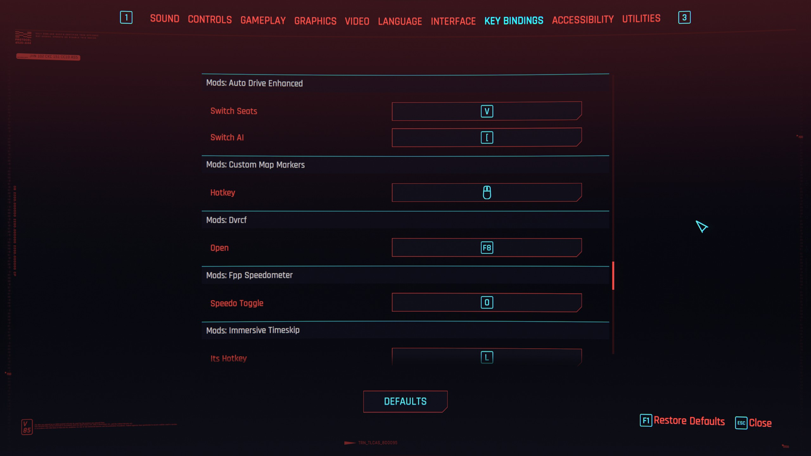

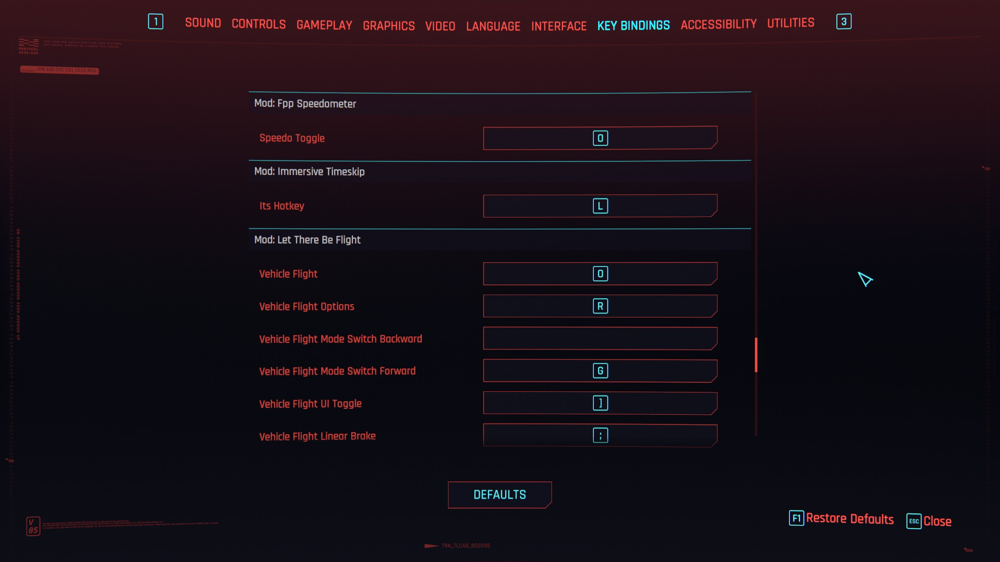

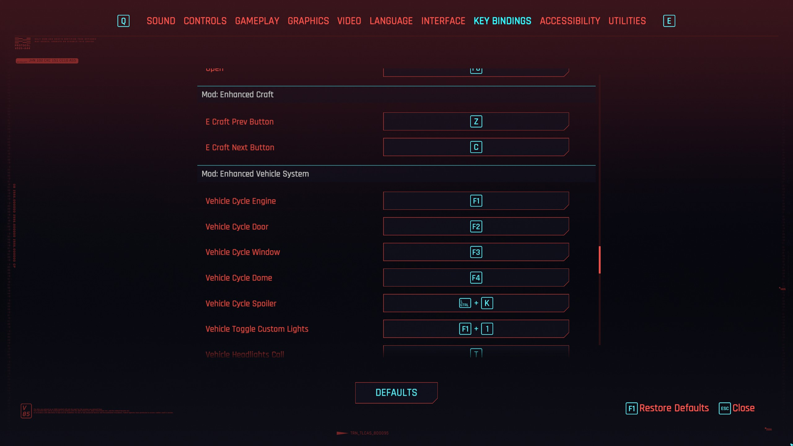

With a controller, the menu shows controller buttons. Here Quicksave is rebound from Y to the D-pad (optional file):

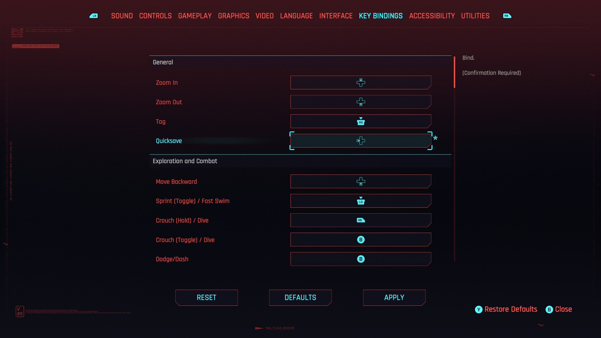

With the optional file, the Control Scheme screen shows your bindings. Defaults, then Crouch and Dodge, Interact and Jump swapped:

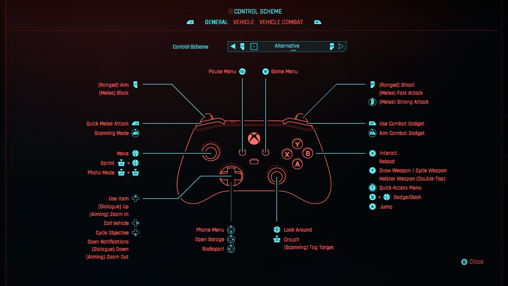

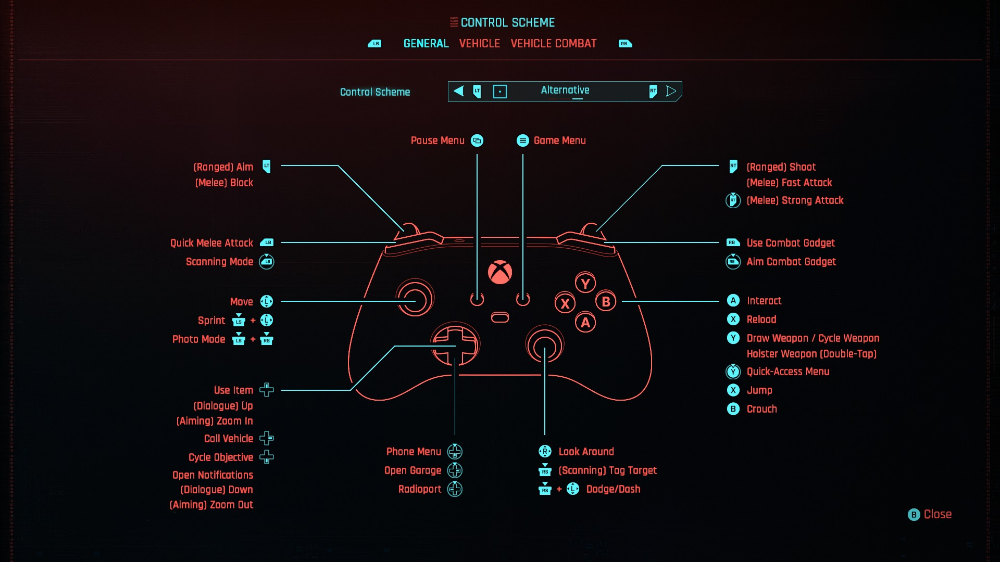

## Features

- One section per mod in Settings > Controls > Key Bindings, for example *"Mod: Let There Be Flight"* or *"Mod: Stash QoL"*, built at startup from the mods you have installed. Add or remove a mod and the sections follow.
- Section and action names come from the mod's files, for example *"Vehicle Flight Linear Brake"* or *"Transfer Max Quantity"*.
- Also lists keys the mod didn't mark as rebindable (for example Enhanced Vehicle System's F1 to F4 and T).
- Key combinations are shown as their keys (for example *"F2 + 2"*) and can be rebound to a single key. Defaults puts the combination back from the next launch.
- Record your own combination: hold one key and press another, for example *"Ctrl + K"* or *"Q + E"*, mouse buttons included. On a controller entry, hold one button and press another, for example *"LB + A"*. A key pressed on its own is bound alone. While an entry waits it says *"Press a key or combination"*, and the side panel says how to bind one.

  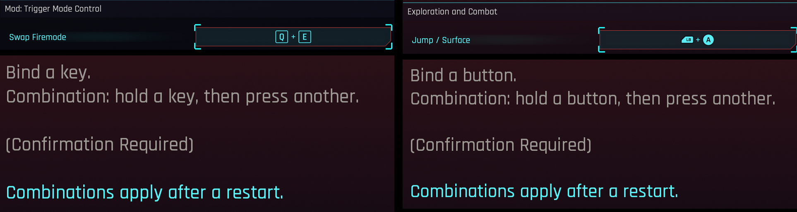

  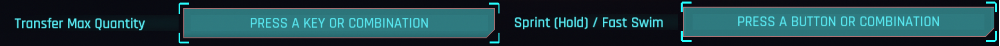
- A (Hold) action can share its key with another action: tap for the other action, hold for this one. For example Sprint (Hold) and Dodge on B, or Crouch (Hold) and Dodge/Dash on Mouse 4. The hold only counts on the device where the key is shared, so a lone Sprint (Hold) key stays instant. A shared controller button works as soon as you bind it; a shared keyboard key after a restart. While the game shows a prompt on that key (talk, loot, pick up), the prompt comes first.

  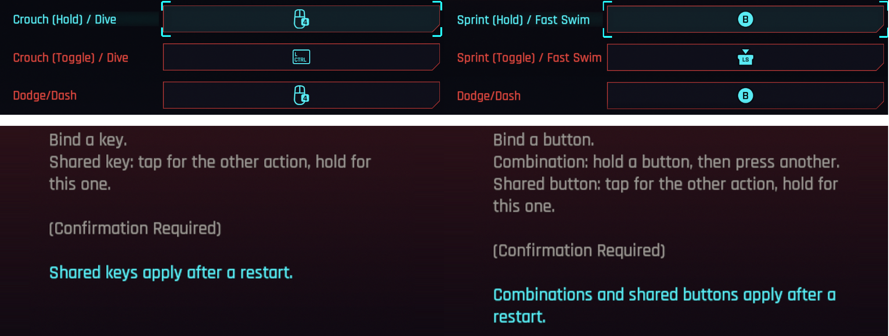

- Conflict warning: when two actions that react at the same time share a key or button, a popup lists the keys, and each entry's side panel names what shares it.

  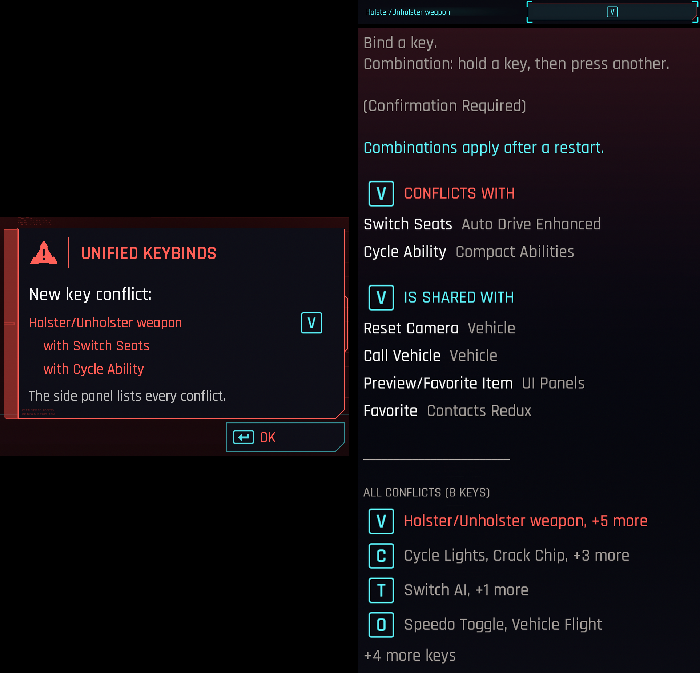

- A changed key applies right away, also for mods without a Mod Settings option.
- Unbind any entry, vanilla or mod, keyboard or controller: point at it and press X (Square on a controller), shown in the hints. It stays unbound across save loads, new games and restarts; Defaults brings the key back. [Allow Unbound Actions](https://www.nexusmods.com/cyberpunk2077/mods/11429) is no longer needed, and still works alongside.
- Controller rebinding, which the game doesn't offer: use a controller in Key Bindings and the menu switches to controller buttons for mod actions. It switches back when you use the keyboard. A controller entry takes only controller buttons of its kind (trigger or button) and a keyboard entry only keys.
- Optional file Vanilla Controller Rebinding: vanilla actions too, with the game's own section names and labels, following the control scheme in use (Classic, Dynamic, Alternative). Each scheme keeps its own layout. The Control Scheme screen draws your bindings. Sprint (Hold), Crouch (Hold) and Scan (Toggle) get controller entries too, unbound by default, like the keyboard has (with Scan (Hold) and Scan (Toggle) on one button, tap is a quick scan and hold switches scanning on or off). Works on all three schemes.

  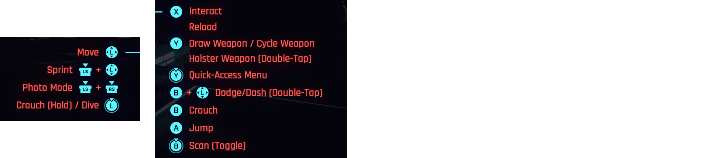

- Keys stay in sync with Mod Settings: if a mod also has its key in Mod Settings, changing it in either menu changes both.
- Also lists the keys that Cyber Engine Tweaks mods add through Native Settings UI (for example Kiroshi Optics Night Vision or Much Better Netrunning). A key changed in either menu changes both, and the mod uses it right away.
- Also lists the keys of mods that keep them in Redscript Configuration Framework (for example DigitalVixen's Shattered Chrome, Chrome Plating or Injuries), with the mod's own names. A key changed here or in RCF's hub changes both.
- Actions already in the Key Bindings menu (vanilla, or added by mods like No More Hard-coded Keybinds) are not listed twice.
- Your keys are kept in a file of their own (`r6/cache/modkeybinds/keys.json`), written safely and with a backup of the previous version (`keys.json.bak`), so removing a mod or a crash doesn't cost your bindings.
- Never changes the game's files or other mods' files, so mods that edit the settings menu keep working.

## Requirements

- Cyberpunk 2077 **2.5**
- [RED4ext](https://www.nexusmods.com/cyberpunk2077/mods/2380)
- [redscript](https://www.nexusmods.com/cyberpunk2077/mods/1511)
- [Input Loader](https://www.nexusmods.com/cyberpunk2077/mods/4575)
- [Codeware](https://www.nexusmods.com/cyberpunk2077/mods/7780)
- [Mod Settings](https://www.nexusmods.com/cyberpunk2077/mods/4885) (optional, for keeping keys in sync with mods that also offer them there)
- [Cyber Engine Tweaks](https://www.nexusmods.com/cyberpunk2077/mods/107) and [Native Settings UI](https://www.nexusmods.com/cyberpunk2077/mods/3518) (optional, for the keys of mods that use Native Settings UI)
- [Redscript Configuration Framework](https://www.nexusmods.com/cyberpunk2077/mods/30726) (optional, for the keys of mods that keep them there)

## Installation

Extract the archive into the Cyberpunk 2077 game folder, or install it with Mod Organizer 2 or Vortex. The files go to:

```
red4ext/plugins/ModKeybindsMenu/ModKeybindsMenu.dll
red4ext/plugins/ModKeybindsMenu/scripts/
bin/x64/plugins/cyber_engine_tweaks/mods/ModKeybindsMenu/init.lua
```

The optional file Vanilla Controller Rebinding adds one file, installed the same way on top of the main file:

```
red4ext/plugins/ModKeybindsMenu/scripts/ModKeybindsMenu/VanillaController.reds
```

## Uninstallation

Remove the `red4ext/plugins/ModKeybindsMenu` and `bin/x64/plugins/cyber_engine_tweaks/mods/ModKeybindsMenu` folders. Optionally delete `r6/cache/modkeybinds/`, where the mod keys are kept. Nothing is written to your save.

Updating from 1.0.0: start the game once with 1.0.1 before uninstalling, so your `UserSettings.json` gets cleaned up.

## For mod authors

Your action shows up if it has a `<button id="IK_..." overridableUI="yourActionName" />` in an input file loaded by Input Loader. A `Button` mapping with a single keyboard or mouse key or key combination (`buttonGroup`) and no `overridableUI` shows up too, under the mapping's name. Nothing else is needed.

For nicer names than the generated ones, ship `r6/config/modkeybinds/<YourMod>.json`:

```json
{
  "_section": "Your Mod",
  "yourActionName": "Open Menu"
}
```

`_section` names the section for every action in that file. Names can also be `LocKey#...` keys.

## How it works

- A RED4ext plugin compares Input Loader's merged `r6/cache/inputUserMappings.xml` with the game's `r6/config/inputUserMappings.xml`. Every `overridableUI` action a mod added becomes an entry, and so does every mod `Button` mapping with a single key and no `overridableUI`.
- The game reads a copy of the merged mappings with `overridableUI` added to those keys (`r6/cache/modkeybinds/inputUserMappings.xml`).
- A key combination's entry holds its `buttonGroup` id, or `IK_LControl+IK_K` for one picked in the menu; the scripts draw it as its keys. At startup a picked combination is written into the action's own mapping in that copy, as a `buttonGroup`, since the game only watches combinations that an action uses when it loads.
- The menu binds a key only once every key is released, so while an entry waits for a key the plugin checks the keyboard and mouse every 10 ms (the controller through XInput) and notes a key pressed while another was held. A controller combination is written into the mapping copy as a `buttonGroup` the same way.
- Shared keys of (Hold) actions: the plugin serves a copy of Input Loader's merged `r6/cache/inputContexts.xml` (`r6/cache/modkeybinds/inputContexts.xml`). A (Hold) action whose key or button another on-foot action also uses gets `acceptedEvents` "hold complete" and "released", so it starts after the game's 0.3 s hold and a tap goes to the other action. An action sharing the key that reacts to a hold gives that up. The Key Bindings menu checks conflicts through the `Settings*` contexts, which leave the shareable (Hold) actions out in the copy, so both entries keep the key; the game doesn't apply a keyboard key another binding uses, so the plugin writes it into the mapping copy.
- The game keeps an action's accepted events per action, the same for every device. Its runtime object for an action holds a keyboard and a controller copy, and one in use that follows the device. Two hooks found by their code (the action object's constructor and the registration of an action's mapping, game 2.5) set those copies: the long press stays only on the device where the key is shared, and a script system reports the device in use (`InputSchemes.Device`). An object that doesn't look as expected is left alone.
- When the game reads `r6/config/settings/platform/pc/options.json`, the plugin hands it a copy with one group per mod added, written to `r6/cache/modkeybinds/options.json`. The original file stays untouched.
- Each section is named after the mod's folder or input file name; each action after its `overridableUI` name, minus a prefix that repeats the mod's name or initials.
- The game resets every setting if `UserSettings.json` holds a group the menu doesn't define, which would happen after removing a mod with keys. So the mod sections never go into that file: the game reads a copy with them added (`r6/cache/modkeybinds/UserSettings.read.json`), and what it writes is split again, mod keys into `r6/cache/modkeybinds/keys.json`, everything else into `UserSettings.json`.
- A redscript system copies Mod Settings key options into the menu when a save loads, since Mod Settings applies its keys at startup, and copies menu changes back to Mod Settings.
- The game only applies key binding settings to its own actions. The plugin hooks the game's ApplyOverrides and sets the menu's key on every mapping that carries a listed action, at startup and when a key changes, the way Mod Settings does for its own options. A changed key is applied on the game's main thread at the next frame (a RED4ext Running state), never from the thread the scripts run on.
- The menu shows labels through the game's translation system, so `options.json` holds keys like `ModKeybindsMenu-itsHotkey` and the scripts register the label text for every language through Codeware.
- A small CET script (`bin/x64/plugins/cyber_engine_tweaks/mods/ModKeybindsMenu/init.lua`) reads the key bindings in Native Settings UI and hands them to the plugin, which lists them from the next launch (`r6/cache/modkeybinds/nativesettings.json`). A key changed in Key Bindings goes to the mod through Native Settings UI when changes are applied or the settings menu closes; a key changed in Native Settings UI, Unified Mod Settings or by the mod itself goes to Key Bindings within a second.
- Mods that use Redscript Configuration Framework bind their actions to an empty `buttonGroup` and RCF puts the key in place. RCF stores each mod's page and values in `r6/storages/RedscriptConfigFramework` (`<mod>.cached.json`, `<mod>.json`); the plugin lists the keys from there with RCF's labels and the mod's current key, and leaves out placeholder actions RCF doesn't list. The menu entry sets the binding, so the scripts copy a change to RCF (`DVRCF.SetInt`, or RCF's settings for its hub key) and check RCF every 2 seconds, when a session starts and when the settings menu opens, to copy changes made in its hub.
- Controller entries: the game's key binding entries take keyboard keys only. For every action (vanilla or mod) whose mappings hold exactly one controller button without `overridableUI`, the plugin adds an entry named `MKPad_<action>` and gives that button the name as `overridableUI` in the copy of the mappings the game reads. Vanilla ones are added only while the optional `VanillaController.reds` is installed, in sections named after the game's, with its labels. Their buttons come from the mapping's copy for the control scheme in use (`<mapping>_Legacy`, `_Agile`, `_Alternative`) where the game has one, and buttons used only in menu contexts are left out. `VanillaController.reds` also moves the rows on the Control Scheme screen to the buttons they are bound to. The scripts show controller entries while the last device used is a controller (the game's `InputSchemes.Device` blackboard) and the keyboard entries otherwise, and rebuild the list when the device changes. The ApplyOverrides hook sets controller buttons only for controller entries.
- Unbinding sets an entry to `IK_None`, the game's value for an action without a key, which the plugin keeps in `keys.json` as the player's choice. An entry with no stored key was never set and gets the mod's key. The game won't keep the menu's changes while an action has no key (`IsBlockedByActionWithoutAssignedKey`); the scripts wrap that method rather than replace it, so Allow Unbound Actions, which replaces it, still compiles alongside. The Unbind key is the game's `controller_settings` action (X, Square), which does nothing on the Key Bindings tab.
- Defaults resets an entry to the key the game knows for it, which it only knows for its own actions, so the scripts set mod entries to the mod's key.
- Shared controller buttons apply during play: every (Hold) action that may share gets its hold rule when the game starts (taking every event while unshared), and the plugin switches the controller side of the rule when a button changes. A controller entry without a default button has a row with a key no device sends, so a button bound later works at once. Shared keyboard keys are written into the mappings copy and apply after a restart.
- Conflicts: two entries on one key count when their actions are in one gameplay context (or one of them is read by the mod itself), at least one is a mod's entry or both are game controller entries, and they are not a (Hold) entry sharing by design. The popup shows the device in view.
- Game controller keys are stored per control scheme (`_schemes` in `keys.json`).
- Classic scheme: the game counts the dodge's double tap itself and misses it on a button that also has a hold (the press is held back and arrives with the release). With Dodge/Dash moved off its default button, the plugin adds a plain action on the dodge's button and the scripts count the double tap with the game's timing (each press up to 0.2 s). The default button is left to the game.
- Dynamic scheme: the game makes Crouch (Toggle) a hold on the controller so B can dodge on a tap. With crouch on another button than the dodge, the plugin sets it to react to a tap.
- Scan (Hold) and Scan (Toggle) on one button: tap is a quick scan, hold toggles. On Alternative the game has no quick scan (the button is also Quick Melee); with the two on different buttons the optional file adds it.
- Files are written through a temporary file and moved into place. `keys.json.bak` is the version before the last save; a `keys.json` that can't be read is copied to `keys.json.bad`.
- What was found is written to `red4ext/logs/modkeybindsmenu-*.log`.

## Building

Needs Visual Studio 2022 Build Tools (C++ workload), CMake and Ninja.

```
git clone --recursive https://github.com/kaporli/unified-keybinds
tools\package.ps1
```

The plugin is built to `package/` and the release zips (main and optional file) to `dist/`.

## License

MIT, see [LICENSE](LICENSE). Uses [RED4ext.SDK](https://github.com/wopss/RED4ext.SDK), [pugixml](https://github.com/zeux/pugixml) and [nlohmann/json](https://github.com/nlohmann/json), all MIT. The input manager layouts and address hashes come from [Mod Settings](https://github.com/jackhumbert/mod_settings) (MIT).
